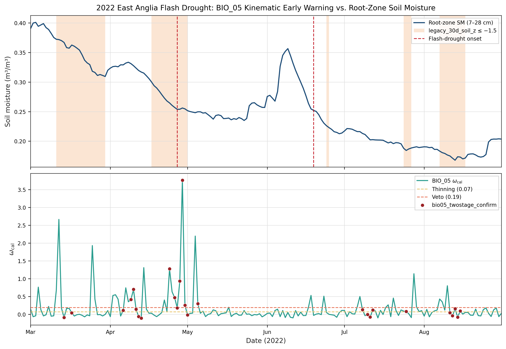
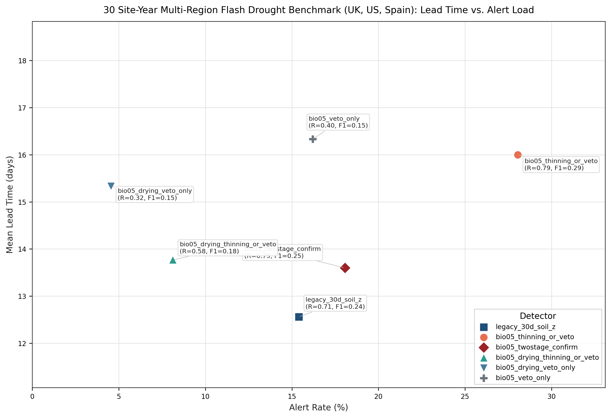

# Scale-Invariant Covariant Kinematic Auditing for Environmental Tipping Points

[](https://doi.org/10.5281/zenodo.24404720)
[](https://github.com/Regsiren/covariant-sentinel-earth)
[](https://www.python.org/)

**Repository:** [`covariant-sentinel-earth`](https://github.com/Regsiren/covariant-sentinel-earth)  
**Zenodo preprint:** [DOI 10.5281/zenodo.24404720](https://doi.org/10.5281/zenodo.24404720)

## Overview

This repository validates **zero-shot transfer** of `CovariantSentinelAuditor` — a streaming, scale-invariant kinematic auditor with **unchanged** invariant weights (`Ω0=0.05`, `α=0.12`, `β=0.08`, `γ=0.02`) and phase thresholds (`0.07` / `0.19`) — across two environmental domains without re-fitting. **Path A** (`ATMOS_02` + `HELIOS_01`) tests whether heliospheric uncertainty coupling improves London multi-day high-pressure block detection over chance and finds a **null**. **Path B** (`BIO_05`) applies the same auditor to a **30 site-year** flash-drought early-warning benchmark (East Anglia, Iowa Corn Belt, Castile; 2015–2024; 38 events), with site-year block bootstrap confidence intervals and paired deltas versus a legacy 30-day soil-moisture Z baseline.

## Key Empirical Results

### Path B — `BIO_05` flash drought (30 site-years, 38 events)





Pooled 30 site-year summary (point estimates). Highlight: `bio05_thinning_or_veto` gains **+3.44 days** mean lead versus `legacy_30d_soil_z` (95% site-year block bootstrap CI **[+0.15, +6.55]**; recall **0.789**, F1 **0.260**). Ops-efficiency highlight: `bio05_drying_thinning_or_veto` at **8.12%** alert rate and **1.87** lead-days per 100 false-alert days.

| Detector | Recall | Precision | F1 | Mean lead (d) | Alert rate (%) | False-alert days | Lead / 100 FA |
|---|---:|---:|---:|---:|---:|---:|---:|
| `legacy_30d_soil_z` | 0.711 | 0.148 | 0.245 | 12.56 | 15.40 | 1312 | 0.96 |
| `bio05_thinning_or_veto` | 0.789 | 0.175 | 0.287 | 16.00 | 28.05 | 2806 | 0.57 |
| `bio05_veto_only` | 0.395 | 0.095 | 0.153 | 16.33 | 16.20 | 1655 | 0.99 |
| `bio05_drying_thinning_or_veto` | 0.579 | 0.107 | 0.181 | 13.77 | 8.12 | 736 | 1.87 |
| `bio05_drying_veto_only` | 0.316 | 0.095 | 0.146 | 15.33 | 4.54 | 416 | 3.69 |
| `bio05_twostage_confirm` | 0.789 | 0.147 | 0.248 | 13.60 | 18.06 | 1615 | 0.84 |

Paired Δ lead vs `legacy_30d_soil_z` (1,000 site-year block bootstrap replicates, seed 42): `bio05_thinning_or_veto` **+3.44 d [+0.15, +6.55]**; `bio05_twostage_confirm` **+1.04 d [−2.18, +4.55]**. Full CI tables: [`outputs/multi_region_bio_report.md`](outputs/multi_region_bio_report.md).

### Path A — `ATMOS_02` + `HELIOS_01` (London, 2022–2024, 17 persistent blocks)

Atmosphere-only kinematic auditing (`uncoupled_atmos`) reaches **100.0%** block recall versus **76.5%** for a legacy Z detector at the **same alert rate**. Direct solar→surface coupling (`coupled_helios_atmos`) is **not distinguishable from chance** under a 50-shift circular permutation null (**p = 0.7843**).

| Detector / test | Result |
|---|---|
| `uncoupled_atmos` recall | **100.0%** (matched alert rate) |
| Legacy Z recall | **76.5%** (matched alert rate) |
| Persistent blocks scored | 17 (London, 2022–2024) |
| Coupling null (precision / F1) | aligned ≈ null mean; **p = 0.7843** (50 circular shifts) |
| Coupling null (mean lead, h) | aligned 55.71 vs null mean 55.07; p = 0.3529 |

**Verdict:** Path A falsifies direct heliospheric–surface block coupling on this sample and motivates the Path B agro-hydrological pivot.

## Repository Structure

```
covariant-sentinel-earth/
├── src/
│   ├── kinematic_core.py      # CovariantSentinelAuditor (invariant weights)
│   ├── coupling_engine.py     # HeliosAtmosCoupler (EWMA excess lag)
│   ├── benchmark_runner.py    # ATMOS events / blocks + permutation nulls
│   ├── bio_benchmark.py       # Flash-drought labels, detectors, bootstrap CIs
│   └── data_loaders.py        # NASA OMNI2 + Open-Meteo ERA5 (atmos / agro)
├── scripts/
│   ├── run_live_validation.py
│   ├── run_bio_validation.py
│   ├── run_multi_region_bio.py
│   └── generate_figures.py
├── tests/
├── outputs/
│   ├── figures/
│   │   ├── fig1_2022_east_anglia_drought.png
│   │   └── fig2_multi_region_pareto.png
│   └── multi_region_bio_report.md
├── CITATION.cff
├── requirements.txt
└── README.md
```

## Quickstart & Exact Reproduction

```bash
pip install -r requirements.txt

# Unit / integration suite (expect 15/15 passing)
pytest

# Path A — HELIOS→ATMOS London blocks (2022–2024)
python scripts/run_live_validation.py --start 2022-01-01 --end 2024-12-31 --mode blocks

# Path B — 30 site-year multi-region flash-drought benchmark + bootstrap CIs
python scripts/run_multi_region_bio.py

# Publication figures (300 DPI → outputs/figures/)
python scripts/generate_figures.py
```

Optional single-region BIO check:

```bash
python scripts/run_bio_validation.py
```

Dependencies: `numpy`, `pandas`, `scipy`, `pytest`, `requests`, `matplotlib`. Live scripts require network access to NASA OMNI2 and Open-Meteo ERA5.

## Citation & Related Prior Work

If you use this repository or its results, please cite the Zenodo record:

```bibtex
@software{olaiya_2026_covariant_sentinel_earth,
  author       = {Olaiya, Remi},
  title        = {{Scale-Invariant Covariant Kinematic Auditing for
                   Environmental Tipping Points: A 30 Site-Year Flash
                   Drought Benchmark and Falsification of Direct
                   Solar–Surface Coupling}},
  month        = nov,
  year         = 2026,
  publisher    = {Zenodo},
  doi          = {10.5281/zenodo.24404720},
  url          = {https://doi.org/10.5281/zenodo.24404720}
}
```

GitHub also exposes a **Cite this repository** button via [`CITATION.cff`](CITATION.cff).

**Related prior Zenodo records**

- [10.5281/zenodo.23677470](https://doi.org/10.5281/zenodo.23677470)
- [10.5281/zenodo.20549045](https://doi.org/10.5281/zenodo.20549045)
- [10.5281/zenodo.20548468](https://doi.org/10.5281/zenodo.20548468)

## Intellectual Property & Patent Notice

The validation scripts, benchmark harness, and reproducibility artefacts in this repository are made publicly available for **academic verification, peer review, and non-commercial research reproducibility**.

The underlying `CovariantSentinelAuditor` / **Auditor OS** architecture, orthogonal shear state-gating methodology, and associated inventions are **proprietary** and subject to **patent-pending** rights held by **Thohat Ventures Ltd** (Remi Olaiya). Commercial deployment, integration, or licensing enquiries should be directed to the author.

## Author

**Remi Olaiya**  
Principal, Thohat Ventures Ltd  
ORCID: [0009-0002-6809-5061](https://orcid.org/0009-0002-6809-5061)

## Data Attribution

NASA OMNI2 and Copernicus ERA5 (via Open-Meteo) remain subject to their respective data policies. Please cite the data providers alongside this work when reusing results or figures.
